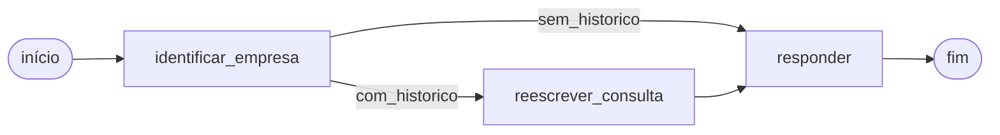
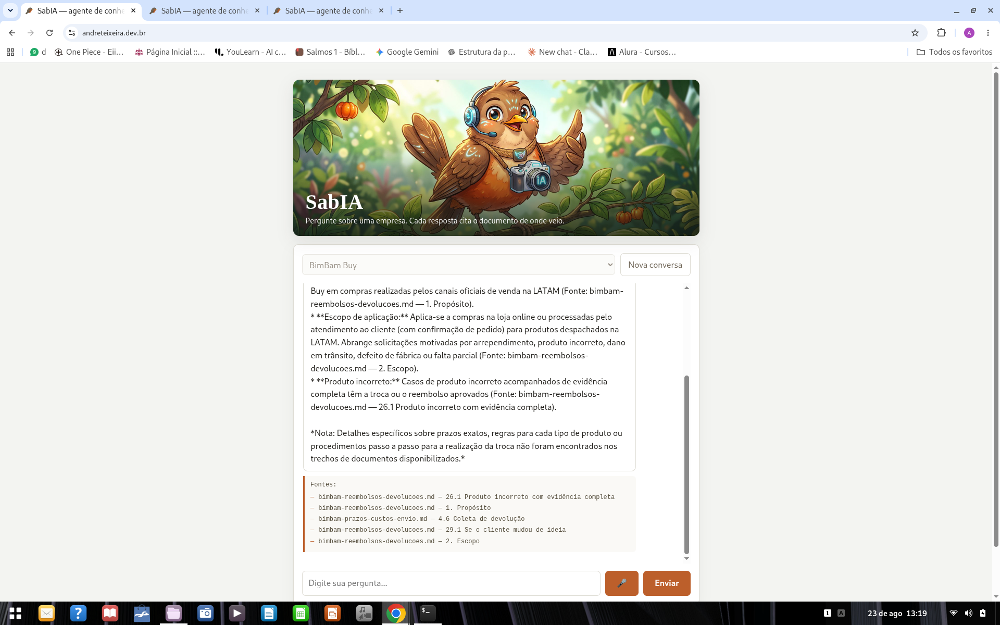
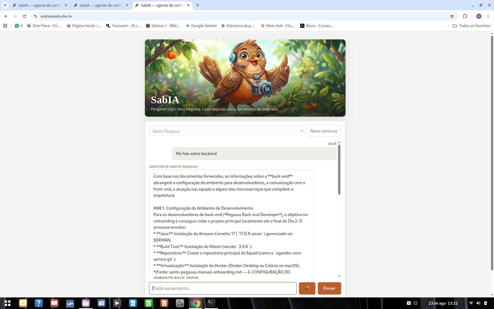
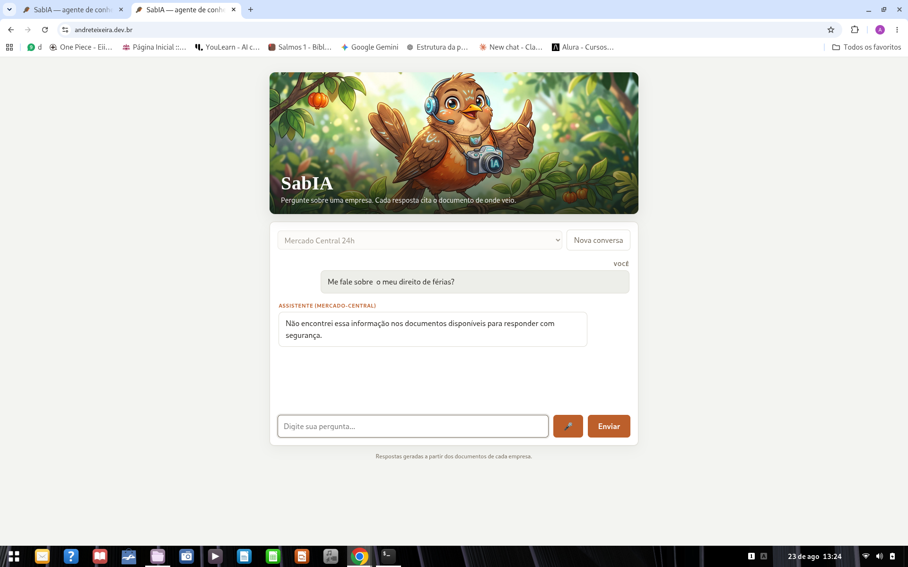

# SabIA — agente RAG multi-empresa

[](https://github.com/AndreTeixeir/agente-rag-multiempresa/actions/workflows/ci.yml)

Agente conversacional que responde perguntas sobre a documentação interna de três empresas
fictícias, mantendo isolamento estrito entre elas: a mesma pergunta feita a empresas
diferentes recupera documentos diferentes e produz respostas diferentes.

Projeto do **Challenge RAG — Alura / Oracle ONE (Tech AI Builder)**.

🔗 **Aplicação no ar:** https://andreteixeira.dev.br — abre na tela de login; o balão **?** no canto
mostra as contas de demonstração (ver [Login e papéis](#login-e-papéis)).

O nome vem do sabiá — pássaro brasileiro conhecido pelo canto, com "IA" no meio e um aceno
a "sábio". A interface aceita pergunta por voz, o que fecha o trocadilho.

---

## O problema

Três empresas, 14 documentos, um só agente. O risco central de um RAG multi-tenant é o
vazamento entre bases: perguntar "qual o prazo de arrependimento?" precisa devolver a
política da BimBam Buy quando o contexto é BimBam, e a do Mercado Central quando é Mercado
Central — sem misturar, e sem inventar quando a resposta não existe em documento nenhum.

| Empresa | Identificador | Domínio dos documentos |
|---|---|---|
| BimBam Buy | `bimbam` | e-commerce — pagamentos, envio, garantia, reembolso, afiliados |
| Mercado Central 24h | `mercado-central` | varejo alimentar — SOP, fornecedores, trocas, FAQ |
| Santo Pegasus | `santo-pegasus` | engenharia de software — arquitetura, onboarding, SRE, guias |

---

## Arquitetura

Camadas simples, deliberadamente não hexagonal. Duas portas isoladas, e apenas duas:
`EmbeddingProvider` (permite trocar o provedor de embeddings) e `VectorStore` (permite
trocar o pgvector). Tudo o mais é implementação direta.

### Fluxo do grafo



Três nós, com aresta condicional em `identificar_empresa`:

- **`identificar_empresa`** — resolve a empresa da sessão. Regra de produto: a empresa fica
  fixa até o fim da conversa; tentar trocá-la no meio é ignorado, e mudar exige nova thread.
- **`reescrever_consulta`** — só alcançado quando há histórico. Transforma "e para
  hortifrúti?" numa pergunta autossuficiente, sem a qual a busca vetorial não recupera nada
  útil. É uma chamada ao modelo de chat.
- **`responder`** — recuperação filtrada por empresa, aplicação do limiar e geração da
  resposta com citação de fonte.

**Estado:** empresa selecionada + histórico em janela deslizante de 6 turnos.
**Checkpointing:** `langgraph4j-postgres-saver`, no mesmo Postgres do pgvector. As tabelas
vêm da migração `V3__grafo_checkpoints.sql`, com `createTables(false)` explícito — schema é
responsabilidade do Flyway, nunca de criação automática.

### As duas comportas contra alucinação

O sistema recusa em dois pontos distintos, e isso é intencional:

1. **Comporta 1 — limiar de similaridade.** Se o melhor chunk fica abaixo de `0.68`, a
   pergunta é barrada antes de chegar ao LLM. Nenhuma chamada de geração acontece.
2. **Comporta 2 — prompt de sistema.** Quando o contexto recuperado é topicamente
   relacionado mas não contém o fato pedido, o limiar sozinho deixa passar. O prompt exige
   que o modelo admita ausência em vez de completar a lacuna.

A comporta 2 existe porque a separação por limiar **não é limpa**. Perguntar o CNPJ da
BimBam recupera chunks de pagamento e logística com score `0.7759` — acima do limiar, e
ainda assim sem a resposta. Um limiar mais alto barraria fatos legítimos: o menor score
entre perguntas com resposta real foi `0.7201`.

---

## Tecnologias

| Camada | Escolha |
|---|---|
| Linguagem / runtime | Java 21 |
| Framework | Spring Boot 4.1.0 |
| Orquestração de LLM | LangChain4j 1.18.1 |
| Grafo de estado | LangGraph4j 1.9.0-beta2 (`langgraph4j-core` + `langgraph4j-postgres-saver`) |
| Banco vetorial | PostgreSQL 16 + pgvector |
| Migrações | Flyway (`V1` chunks, `V2` chunks recursivo, `V3` checkpoints, `V4` limites diários, `V5` contas) |
| Embeddings | `gemini-embedding-001`, 768 dimensões, normalização L2 manual |
| Geração | Sabiazinho-4 (`sabiazinho-4`), da Maritaca, pela API compatível com a OpenAI |
| Interface | HTML/JS estático servido pelo próprio Spring Boot |
| Login | Spring Security 7.1.0; sessão por cookie com JWT HS256 (`spring-security-oauth2-jose`, Nimbus 10.9); senhas com BCrypt |
| Entrada por voz | Web Speech API (`SpeechRecognition`), `pt-BR` |
| Testes | JUnit 5, AssertJ, Mockito, Testcontainers |
| CI | GitHub Actions — `./mvnw test` em todo push e pull request |
| Deploy | OCI Ampere A1 (ARM64), Ubuntu 24.04, systemd, Caddy + Let's Encrypt |

---

## Como executar

### Pré-requisitos

- Java 21
- Docker e Docker Compose
- Uma chave de API do Google AI Studio (embeddings) e uma da Maritaca (geração das respostas)

### 1. Banco

```bash
docker compose up -d
```

Sobe `pgvector/pgvector:pg16` na porta **5434** (não a 5432, para não colidir com um
Postgres local), banco `agenterag`, usuário e senha `rag`. O Flyway aplica as migrações no
boot da aplicação.

### 2. Chaves de API

Crie um arquivo `.env` na raiz do projeto:

```properties
GEMINI_API_KEY=sua-chave-do-google-aqui
MARITACA_API_KEY=sua-chave-da-maritaca-aqui
```

`GEMINI_API_KEY` é a dos embeddings (ingestão e consulta); `MARITACA_API_KEY` é a da geração
das respostas.

```bash
chmod 600 .env
```

O `.env` é carregado por `spring.config.import: optional:file:.env[.properties]`. **O
sufixo `[.properties]` é obrigatório** — sem ele o Spring não reconhece a extensão, ignora
o arquivo em silêncio e a chave chega ao Google como o literal `${GEMINI_API_KEY}`.

O mesmo vale para uma variável ausente: o boot não falha, e a chave chega à API como o literal
`${MARITACA_API_KEY}` — as perguntas deixam de ser respondidas, sem erro na subida.

### 3. Ingestão

Roda uma vez, por perfil dedicado, e encerra:

```bash
./mvnw spring-boot:run -Dspring-boot.run.profiles=ingest
```

Nunca ingere no boot da aplicação web. Há guarda de idempotência: se a tabela já tem
chunks, a ingestão é pulada.

⚠️ A ingestão respeita `pausa-entre-chamadas-ms: 65000` — 65 segundos entre documentos,
para caber no limite de embeddings por minuto do free tier. Ingerir os 14 documentos leva
cerca de 15 minutos, e isso é esperado.

### 4. Aplicação

```bash
./mvnw spring-boot:run
```

Interface em `http://localhost:8080`, health em `/health`. A página abre na tela de login: use uma
das contas de demonstração (ver [Login e papéis](#login-e-papéis)). Sem `APP_AUTH_JWT_SECRET`, o
aplicativo gera um segredo aleatório a cada boot e avisa no log — cômodo no notebook; as sessões
deixam de valer a cada reinício.

### Variáveis de ambiente

| Variável | Default | Observação |
|---|---|---|
| `GEMINI_API_KEY` | — | obrigatória — embeddings |
| `MARITACA_API_KEY` | — | obrigatória — geração das respostas |
| `DB_URL` | `jdbc:postgresql://localhost:5434/agenterag` | |
| `DB_USERNAME` | `rag` | |
| `DB_PASSWORD` | `rag` | |
| `SERVER_PORT` | `8080` | em produção, `8000` via systemd |
| `APP_AUTH_JWT_SECRET` | gerado ao acaso a cada boot, com aviso | segredo que assina o token da sessão; **em produção, defina**. Pelo menos 32 bytes (o app não sobe com menos); por exemplo, `openssl rand -base64 48` |
| `APP_AUTH_COOKIE_SEGURO` | `true` | atributo `Secure` do cookie. No Chrome ele funciona em `http://localhost`; para rodar por `http://` fora do localhost, ou num cliente que não o aceite, use `false` |
| `APP_SUPERADMIN_USUARIO` | — | usuário do superadmin real (ver [O superadmin real](#o-superadmin-real)). Só vale junto com a senha |
| `APP_SUPERADMIN_SENHA` | — | senha do superadmin real: de 8 caracteres a 72 bytes. Nunca vai para o log |

### Perfil alternativo de chunking

```bash
./mvnw spring-boot:run -Dspring-boot.run.profiles=recursivo
```

Troca a estratégia híbrida pela recursiva e aponta para a tabela `document_chunks_recursive`.
Existe para tornar a decisão de chunking mensurável, não teórica — ver seção de avaliação.

---

## Login e papéis

O chat exige login. Cada conta tem um papel, e o papel decide o que ela alcança:

| Papel | Chat | Administração de contas |
|---|---|---|
| `USUARIO` | só a empresa da conta | nenhuma |
| `ADMIN` | só a empresa da conta | lista, cria e exclui usuários comuns da **própria** empresa. Não cria administrador e não escolhe a empresa: o servidor força o papel (usuário) e a empresa ao criar |
| `SUPERADMIN` de demonstração | qualquer empresa | lista todas as contas (menos o superadmin real); cria administradores e usuários em qualquer empresa (pode haver vários administradores por empresa); exclui as contas que não são protegidas |
| `SUPERADMIN` real | qualquer empresa | o mesmo, sem a trava das contas que ele mesmo criou, e fora dos limites de perguntas e de cadastros |

**Contas protegidas** são as que as contas de demonstração não alteram nem excluem: as 7 semeadas,
o superadmin real e as criadas por ele. Ninguém exclui as semeadas (fazem parte da demo, e o reset
não as recria), o superadmin real nem a si mesmo. Só o `SUPERADMIN` exclui administradores. As contas
criadas pelo superadmin real, só ele exclui.

### Contas de demonstração

Criadas pela migração `V5`. A senha de todas é pública: **`sabia-demo`**.

| Usuário | Papel | Empresa |
|---|---|---|
| `superadmin.demo` | `SUPERADMIN` | todas |
| `admin.bimbam` | `ADMIN` | BimBam Buy |
| `usuario.bimbam` | `USUARIO` | BimBam Buy |
| `admin.mercadocentral` | `ADMIN` | Mercado Central 24h |
| `usuario.mercadocentral` | `USUARIO` | Mercado Central 24h |
| `admin.santopegasus` | `ADMIN` | Santo Pegasus |
| `usuario.santopegasus` | `USUARIO` | Santo Pegasus |

### O balão de ajuda

Um botão **?** fixo no canto, em todas as telas. Na tela de login ele mostra as 7 contas em cartões,
com usuário, senha e um botão **Entrar** (que preenche os campos e envia), e um guia curto: escolher
a conta, perguntar, cadastrar um usuário como administrador e entrar com ele, o que o superadmin vê,
os limites e o reset. Depois do login ele explica o que o papel da conta pode fazer e oferece
**Trocar de conta**. Abre sozinho na primeira visita; depois fica fechado até o clique (a marca fica
no `localStorage`, e a página funciona igual se ele não estiver disponível).

### Reset diário

À meia-noite de `America/Sao_Paulo`, o mesmo fuso dos limites, a aplicação apaga as contas que não
são semeadas, não são o superadmin real e não foram criadas por ele, e **todas** as conversas, e
registra no log uma linha com as contagens. Quem estava com uma conversa aberta continua: a próxima
mensagem começa uma conversa nova, sem erro (o `PostgresSaver` do LangGraph4j 1.9.0-beta2 não guarda
nada das conversas em memória — conferido no código da biblioteca —, então apagar as linhas basta).

Se o aplicativo estava fora do ar à meia-noite, o reset roda no primeiro boot do dia: cada execução
reivindica o dia com uma linha `reset-diario` em `limite_diario`, inserida de forma atômica, então ele
roda uma vez por dia mesmo com reinícios ou mais de uma instância. A reivindicação e o apagar são uma
transação só.

### Rotas

| Método | Caminho | Quem |
|---|---|---|
| `POST` | `/api/auth/login` | público (10 erradas por IP por hora, depois 429) |
| `POST` | `/api/auth/logout` | público; apaga o cookie |
| `GET` | `/api/auth/eu` | qualquer conta logada |
| `POST` | `/api/chat` | qualquer conta logada |
| `GET` | `/api/contas` | `ADMIN`, `SUPERADMIN` |
| `POST` | `/api/contas` | `ADMIN`, `SUPERADMIN` — 201 |
| `DELETE` | `/api/contas/{id}` | `ADMIN`, `SUPERADMIN` |
| `POST` | `/api/admin/ingest` | só no perfil `dev`, e só `SUPERADMIN` |
| `GET` | `/`, arquivos estáticos, `/health`, `/actuator/health` | público |

Todo o resto responde 401 sem login. Os erros têm o formato `{"erro": "..."}`, com mensagem em
português: 401 sem login ou com token inválido ou vencido, 403 quando o papel não permite, 404 para
uma conta que quem pediu não enxerga (de outra empresa, ou o superadmin real).

### Decisões de segurança

- **Senhas com BCrypt.** O hash fica no banco; a senha nunca é gravada nem vai para o log. Senha nova:
  de 8 caracteres a 72 bytes (o BCrypt só considera os 72 primeiros). Usuário inexistente também roda
  a conferência do BCrypt, e a mensagem de erro é a mesma para usuário inexistente e senha errada.
- **Cookie `HttpOnly`, `Secure`, `SameSite=Strict`, `Path=/`, 8 horas, sem `Domain`.** O JavaScript da
  página não o lê. Com `Secure`, o nome é `__Host-sabia-sessao`: o prefixo `__Host-` impede um
  subdomínio irmão de plantar um cookie com esse nome para o domínio todo.
- **Token JWT HS256 com só o id da conta.** Emissor, `iat` e `exp` obrigatório; token com outro
  algoritmo (inclusive sem assinatura), outro emissor ou sem validade é recusado. O papel e a empresa
  **não** vão no token: a conta é lida do banco a cada requisição, então excluir uma conta, ou o reset,
  encerra a sessão dela na hora. O segredo vem de `APP_AUTH_JWT_SECRET`.
- **Barreira de CSRF: conferência do `Origin`.** Em `POST`, `PUT`, `PATCH` e `DELETE`, se o navegador
  mandou `Origin`, ele precisa ser o do próprio site, senão 403. O `SameSite=Strict` sozinho não
  bastaria: `sentiment.andreteixeira.dev.br` é servido pelo mesmo Caddy, que repassa para outra VM, e
  é do mesmo *site* que `andreteixeira.dev.br`: uma página de lá consegue mandar uma requisição com o
  cookie, mas o `Origin` dela é outro. Vale também para o login (*login CSRF*). Sem `Origin` a
  requisição passa, porque os navegadores o mandam nessas requisições e a ausência indica um
  cliente sem navegador (curl, teste); o esquema esperado vem de `APP_AUTH_COOKIE_SEGURO`, exceto
  no próprio loopback, onde `http` e `https` valem (é como se roda no notebook). Escolhi isto em
  vez do token CSRF do Spring porque o front é uma página estática: o token exigiria ler o cookie
  no JavaScript, uma requisição de partida para semeá-lo e um login que o recebe antes de existir
  sessão.
- **A conversa é presa à conta.** No grafo, ela se chama `<id da conta>:<threadId>`: uma conta nunca
  alcança a conversa de outra, mesmo sabendo o `threadId` dela. O `threadId` é validado (1 a 64 letras,
  números, hífen ou sublinhado).
- **A empresa vem da conta.** Para `USUARIO` e `ADMIN`, o `empresaEscolhida` que vier no corpo é
  ignorado. Só o `SUPERADMIN` escolhe a empresa, e a interface dele manda a empresa em toda mensagem.
- **Papel por rota, regra fina no serviço.** As rotas de administração exigem o papel na cadeia de
  filtros; o que cada um pode fazer com cada conta é decidido num só lugar, e a mesma decisão alimenta o
  `podeExcluir` da listagem e a recusa do `DELETE`. Não uso `@PreAuthorize`: o
  `@ExceptionHandler(Exception.class)` do projeto engoliria o `AccessDeniedException` e responderia 500.

### O superadmin real

Existe uma conta de superadmin real, que **não** faz parte da demonstração e não está liberada para
uso público. Ela é criada (ou atualizada) no boot a partir de `APP_SUPERADMIN_USUARIO` e
`APP_SUPERADMIN_SENHA`, definidas só no servidor, e nunca aparece em listagem nem na interface (o nome
dela vem mascarado como `superadmin` nas respostas do login). Sem as duas variáveis ela não existe, e o
log diz isso numa linha, sem nome nem senha; com valores inválidos, o log registra o erro, sem os
valores, e a aplicação segue sem ela. Uma linha deixada por um boot anterior não entra enquanto as
variáveis não estiverem definidas.

### Limitações conhecidas

- O logout apaga o cookie, mas o token em si não é revogado: se alguém o tiver copiado, ele vale até
  vencer (8 horas). O cookie `HttpOnly` reduz esse risco; não há lista de revogação.
- O cookie `Secure` em `http://localhost` foi testado no Chrome. Outros navegadores e ferramentas de
  linha de comando não foram testados (ver `APP_AUTH_COOKIE_SEGURO`).
- A conferência do BCrypt também roda para usuário inexistente, para a resposta demorar o mesmo; o
  tempo não foi medido.

---

## Limites da demo

A demo é aberta — as contas de demonstração têm senha pública —, e cada pergunta custa uma ou duas
chamadas ao modelo (duas a partir da segunda pergunta de uma conversa, por causa da reescrita de
consulta). Por isso a demo tem limites, todos em `app.demo.limites`, no `application.yml`. Valem para
todas as contas, **exceto o superadmin real** (nos de perguntas e de cadastros):

| Limite | Valor |
|---|---|
| Perguntas por dia, somando todo mundo | 100 |
| Perguntas por dia, por IP | 10 |
| Tamanho de cada mensagem | 1.000 caracteres |
| Contas criadas pela administração, por dia, no total | 50 |
| Contas criadas pela administração, por dia, por IP | 5 |
| Logins errados, por IP, em cada hora | 10 |

O que acontece quando um limite acaba. A interface mostra a mensagem como um aviso dentro da
conversa (429, 503 e 403), no formulário de login ou de contas, ou no banner de erro acima da
conversa (400), e a conversa continua funcionando:

| Situação | Resposta | Mensagem |
|---|---|---|
| As 100 perguntas do dia acabaram | HTTP 429 | A demo atingiu o limite de perguntas de hoje. Ele volta à meia-noite (horário de Brasília). |
| As 10 perguntas do IP acabaram | HTTP 429 | Você atingiu o limite de perguntas de hoje. Ele volta à meia-noite (horário de Brasília). |
| Os 50 cadastros do dia acabaram | HTTP 429 | A demo atingiu o limite de cadastros de hoje. Ele volta à meia-noite (horário de Brasília). |
| Os 5 cadastros do IP acabaram | HTTP 429 | Você atingiu o limite de cadastros de hoje. Ele volta à meia-noite (horário de Brasília). |
| 10 logins errados do IP na mesma hora | HTTP 429 | Muitas tentativas de login erradas. Tente novamente na próxima hora. |
| Usuário ou senha que não conferem | HTTP 401 | Usuário ou senha inválidos. |
| Mensagem com mais de 1.000 caracteres | HTTP 400 | A mensagem pode ter no máximo 1000 caracteres. |
| O provedor do modelo recusou por limite de uso ou saldo | HTTP 503 | O assistente atingiu o limite de uso no momento. Tente novamente mais tarde. |
| O provedor do modelo não respondeu no tempo limite (30 s por tentativa, com uma nova tentativa) | HTTP 503 | O assistente demorou demais para responder. Tente novamente. |

Como a contagem funciona:

- **Conta pergunta aceita**, antes de o grafo rodar. Mensagem longa demais e pergunta recusada
  por um limite não contam e não chegam ao modelo.
- **Os contadores ficam no Postgres** (migração `V4`), então sobrevivem a reinício e deploy. O
  incremento é um único `INSERT ... ON CONFLICT DO UPDATE`, atômico com requisições
  simultâneas.
- **O dia vira à meia-noite de `America/Sao_Paulo`.**
- **O IP não é gravado em texto**, só o hash SHA-256. As contagens com hash de IP de dias anteriores
  (perguntas, cadastros e tentativas de login) são apagadas; as do total ficam 7 dias.
- **Cadastros** seguem a regra das perguntas (total e IP na mesma transação; recusar pelo IP desfaz o
  total), e excluir uma conta **não** devolve a vaga. A recusa por validação (usuário em uso, senha
  curta) não gasta vaga.
- **Tentativas de login:** a vaga é reservada de forma atômica *antes* de a senha ser conferida —
  então tentativas em paralelo não passam de 10 — e devolvida se o login der certo: só as erradas
  consomem o limite. A chave leva o hash do IP e a hora (`login-ip:<sha256>:<hora>`). Depois das 10
  erradas, nem a senha certa entra até a hora virar.
- **O IP vem do `X-Forwarded-For`**, enviado pelo Caddy, por
  `server.forward-headers-strategy: native`. O Tomcat só aceita o cabeçalho quando a conexão
  vem de um proxy interno (loopback e as faixas privadas, por padrão), então quem chegar direto
  à aplicação, de fora dessas faixas, não consegue forjar o próprio IP. Para que as faixas
  privadas também não cheguem a ela, em produção a aplicação escuta só no loopback
  (`127.0.0.1:8000`, pelo `SERVER_ADDRESS` do `deploy/sabia.service`): outras máquinas,
  inclusive da rede privada, não a alcançam, e quem a chama é o Caddy, na mesma VM.

---

## Testes

```bash
./mvnw test
```

396 testes, todos offline. **Exige Docker**: os testes de integração sobem o próprio container.

Os mesmos testes rodam no GitHub Actions a cada push e pull request
(`.github/workflows/ci.yml`, Java 21 Temurin), sem Postgres local e sem chaves reais — por
isso o teste de contexto também usa Testcontainers e chaves falsas.

Testes que consomem API paga levam `@Tag("llm")` e ficam **fora** do `mvn test` padrão. Para
rodar um deles explicitamente:

```bash
./mvnw test -Dtest=NomeDaClasse -Dgroups=llm -Dsurefire.excludedGroups=
```

`MaritacaSmokeTest` e `GeminiEmbeddingSmokeTest` fazem, cada um, uma única chamada real: a da
geração e a dos embeddings.

O `-Dsurefire.excludedGroups=` é obrigatório. Um valor literal em `<excludedGroups>` não
pode ser sobrescrito por `-D` — o XML da configuração do plugin vence a propriedade de
sistema, mesmo com nome idêntico. Por isso o `pom.xml` referencia uma property em vez de
fixar o valor.

Esses testes também respeitam uma pausa configurável entre chamadas
(`-Dpausa.resposta.ms`, `-Dpausa.conversa.ms`), para caber no limite de requisições por
minuto do free tier. Sem ela, a suíte estoura no meio e falha sem produzir resultado.

O harness de avaliação lê vetores de uma fixture versionada
(`src/test/resources/query-embeddings-fixture.json`), então mede retrieval em todas as
perguntas do conjunto **sem chamar a API**.

### O teste que vale mais que os outros

`IngestaoIntegrationTest` sobe um Postgres real com pgvector via Testcontainers, aplica as
migrações do Flyway e injeta um `EmbeddingProvider` determinístico — nenhuma chamada de
rede.

O caso central prova o invariante do projeto com uma armadilha deliberada: **o vetor de um
documento da BimBam é construído mais próximo da pergunta do que o vetor correto do Mercado
Central.** Numa busca filtrada por `mercado-central`, ele ainda assim não aparece.

Isso demonstra que o isolamento entre empresas é propriedade do filtro no banco, não
confiança na geometria do embedding. Um teste que só verificasse "a busca retorna o
documento certo" passaria mesmo se o filtro fosse removido.

### Erros do provedor e limites, contra o grafo de verdade

`ErrosDoProvedorIntegrationTest` e `LimitesDiariosIntegrationTest` sobem o grafo real, o
Postgres em container e um Tomcat real, com um servidor HTTP local no lugar do provedor do
modelo — nenhuma chamada paga. Existem porque um teste com o serviço mockado não pega o que o
`CompiledGraph` faz com as exceções (embrulha tudo em `CompletionException`): o mock lança a
exceção direto. O segundo cobre o incremento concorrente, o rollback do total quando o limite
por IP recusa, a retenção, a virada do dia e a leitura do `X-Forwarded-For`.

### Login, contas e reset, contra a aplicação inteira

As classes novas de integração compartilham um Postgres em container (uma vez por execução) e usam o
mesmo servidor falso no lugar do modelo — nenhuma chamada paga:

- `AcessoMatrizIntegrationTest` — a **matriz de acesso**: cada rota nova e o `/api/chat` contra os cinco
  perfis (sem login, `USUARIO`, `ADMIN`, superadmin de demonstração e superadmin real), cada combinação
  com o status esperado, e as regras de exclusão (conta protegida, a si mesmo, o superadmin real, outra
  empresa, administrador).
- `AuthIntegrationTest`, `TokenServiceTest`, `SessaoCookieTest`, `OrigemFilterTest` — o login com as 7
  contas, a mesma resposta para usuário inexistente e senha errada, as 10 tentativas por hora (com
  relógio injetado e em paralelo), o token (assinatura, algoritmo, emissor, expiração, `exp`
  obrigatório), os atributos do cookie e a barreira do `Origin`, inclusive com o `Host` e o loopback.
- `ChatPorContaIntegrationTest` — duas contas com o mesmo `threadId` não alcançam a conversa uma da
  outra (provado pelas chamadas ao modelo: a primeira pergunta de uma conversa faz uma, a segunda faz
  duas), e a empresa vem da conta.
- `ContaAdministracaoIntegrationTest`, `CadastroLimitesIntegrationTest` — criar, listar e excluir, as
  validações, o teto de 5 por IP e 50 por dia (inclusive em paralelo, na virada do dia e com o
  superadmin real de fora).
- `ResetDiarioIntegrationTest` — o que o reset apaga e o que mantém, que roda uma vez por dia, a
  meia-noite de São Paulo, a falha que desfaz tudo, e a conversa que continua sem erro depois do reset.
- `SuperadminRealIntegrationTest` — criado pelas variáveis, ausente sem elas, fora das listagens e dos
  limites.
- `ContasMigracaoTest` — a `V5` num banco zerado: as 7 contas semeadas, os hashes conferem com a senha
  pública e as restrições do banco.

A página foi conferida num Chrome de verdade, comandado pelo protocolo de depuração, contra a
aplicação rodando no notebook: login, papéis, contas, balão, sessão que acaba e `localStorage`
indisponível. Isso não faz parte do `./mvnw test`, e o roteiro dessa conferência não está versionado.

---

## Exemplos de perguntas

**Fatos precisos**
- Quais métodos de pagamento a BimBam Buy aceita?
- Quantos dias de férias um colaborador CLT da Santo Pegasus tem direito após completar 12 meses?
- Qual a temperatura ideal para produtos congelados? *(mercado-central)*

**Colisão entre empresas** — mesma pergunta, respostas diferentes
- Qual o prazo para desistir da compra por arrependimento? *(bimbam vs. mercado-central)*

**Follow-up com histórico** — exige reescrita de consulta
- *"Qual a temperatura ideal para produtos congelados?"* → *"E para hortifrúti?"*
- *"Quantos dias de férias um colaborador CLT tem direito?"* → *"E qual o período mínimo de descanso após ser acionado de madrugada?"*

**Recusa esperada**
- Qual o CNPJ da BimBam Buy? *(fora de escopo, mas topicamente próximo — comporta 2)*
- Qual a capital da França? *(fora de escopo, barrado pela comporta 1)*

---

## Avaliação de retrieval

Conjunto versionado em `src/test/resources/avaliacao.yaml`, em quatro categorias: fatos
precisos, colisões entre empresas, fora de escopo e ambiguidades. Todos os valores esperados
foram lidos dos documentos na etapa de conversão e registrados em `docs/FATOS_VERIFICADOS.md`
antes de virarem asserção — nenhum foi presumido.

Na execução as entradas são achatadas em **43 casos** (colisões expandidas por empresa).
Destes, 36 têm documento esperado; os outros 7 são recusa pura, sem documento a recuperar.

| Estratégia de chunking | Chunks | Documento no top-5 | Documento na posição 1 | Seção correta |
|---|---|---|---|---|
| **Híbrida (por cabeçalho)** — padrão | 719 | 36/36 — 100% | 29/36 — 81% | 17/27 — 63% |
| Recursiva pura | 484 | 35/36 — 97% | 34/36 — 94% | não aplicável |

> **A recursiva ganha em posição 1 e ainda assim foi descartada.** A razão não é a métrica
> agregada, e sim o **tipo de erro** de cada estratégia.
>
> O erro da híbrida é de **ranking**: nos 7 casos fora da primeira posição o documento certo
> está nas posições 2 a 4. Como a busca usa `limit=5`, esses casos entram no contexto do LLM
> de qualquer forma — os 81% subestimam o que o sistema realmente entrega.
>
> O erro da recursiva é de **cobertura**: em `mercado-central-cnpj` o documento correto não
> aparece em nenhuma das cinco posições. Nenhum ajuste de `limit` razoável recupera isso, e
> a segunda comporta admitiria ausência para uma pergunta que **tem** resposta no corpus.
> Isso é estritamente pior que um documento certo em terceiro lugar.

Comparar 81% com 94% seria comparar erros de gravidade diferente. Some-se a isso o `secao`
sempre nulo na recursiva — confirmado por consulta, `484` linhas e `0` com seção preenchida
—, que desliga a citação de seção para toda resposta. A métrica de seção aparece como não
aplicável, e não como 0%, porque a estratégia nunca chega a errar a seção: ela nunca a
atribui.

Das 36 perguntas com documento esperado, 8 mudaram de posição entre as estratégias: 7
melhoraram na recursiva e 1 regrediu. A que regrediu é a de cobertura.

A avaliação roda sem rede: os vetores de consulta estão gravados em
`src/test/resources/query-embeddings-fixture.json`, então as mesmas perguntas e os mesmos
vetores são usados contra corpora diferentes. É o que torna a comparação justa.

A estratégia alternativa continua no repositório — migração `V2`, perfil `recursivo` e tabela
própria — como registro reproduzível da medição.

### Distribuição de scores por categoria

| Categoria | n | Mínimo | Mediana | Máximo |
|---|---|---|---|---|
| Fatos precisos | 19 | 0,7201 | 0,7968 | 0,8770 |
| Colisões entre empresas | 9 | 0,5814 | 0,7436 | 0,7886 |
| Fora de escopo | 10 | 0,5399 | 0,7757 | 0,8029 |
| Ambiguidades e defeitos | 5 | 0,6869 | 0,7432 | 0,8071 |

### Por que o limiar sozinho não basta

O limiar `0.68` foi calibrado contra essa distribuição, não escolhido no papel. Mas os
números mostram que **nenhum limiar separa os dois grupos**:

- menor score entre fatos com resposta legítima: **0,7201** (porta do
  `ai-assistant-service`, Santo Pegasus)
- maior score entre perguntas que deveriam ser recusadas: **0,7759** (CNPJ da BimBam)

Qualquer limiar alto o bastante para barrar o segundo barraria também o primeiro. As
distribuições se sobrepõem porque uma pergunta pode ser topicamente nativa — o CNPJ recupera
chunks reais de pagamento e logística — e mesmo assim não ter resposta no corpus. É
exatamente por isso que existe a segunda comporta.

### Limitação conhecida

De 27 casos com documento correto e seção esperada definida, em 10 o documento bateu mas a
seção recuperada não foi a esperada. O documento certo é recuperado em 100% dos casos; a
granularidade de seção é onde o chunking híbrido ainda erra.

---

## Avaliação das respostas

A avaliação de retrieval mede se o trecho certo chega ao modelo. Esta mede o que chega a quem
pergunta: a resposta final.

### Como foi feita

Em 28/10/2026, com o `sabiazinho-4` e o banco com os 719 chunks da estratégia híbrida. Os 43
casos do `avaliacao.yaml` foram enviados ao `POST /api/chat` — o mesmo caminho do site —, cada
um numa conversa nova. Mais duas conversas de duas perguntas, em que a segunda só faz sentido
com a primeira, testaram a reescrita da consulta e a empresa fixa.

Cada resposta recebeu **certo**, **parcial** ou **errado**, com critérios por categoria:

- **Fatos precisos e colisões com fato esperado:** certo se traz o fato esperado (pelo sentido,
  não pela letra), só com dados da empresa certa e sem nada contraditório ou inventado; parcial
  se o fato vem incompleto, ou acompanhado de afirmação sem apoio no documento que não o
  contradiz; errado se o fato está errado ou ausente, se recusa quando a resposta existe ou se
  inventa.
- **Fora de escopo e colisões com recusa:** certo se admite que não tem a informação, sem
  inventar; errado se inventa ou responde com dados de outra empresa.
- **Ambiguidades e defeitos:** certo se cita os dois valores ou as duas fontes e aponta a
  divergência; parcial se cita os dois sem apontar o conflito, ou um só com ressalva de
  incerteza; errado se escolhe um valor como se fosse certo, inventa um terceiro ou recusa por
  completo.

A nota foi dada por um modelo de linguagem como avaliador (LLM-as-a-judge), em duas avaliações
independentes, com os mesmos critérios e sem uma ver as notas da outra; as divergências ficam
registradas. A primeira também conferiu no texto dos documentos as afirmações extras de 7
respostas; a segunda viu só as respostas e o conjunto de casos.

### Resultado

| Categoria | Casos | Avaliação 1 | Avaliação 2 |
|---|---|---|---|
| Fatos precisos | 19 | 14 / 1 / 4 | 14 / 1 / 4 |
| Colisões entre empresas | 9 | 7 / 1 / 1 | 8 / 0 / 1 |
| Fora de escopo | 10 | 10 / 0 / 0 | 10 / 0 / 0 |
| Ambiguidades e defeitos | 5 | 3 / 1 / 1 | 4 / 0 / 1 |
| **Total** | **43** | **34 / 3 / 6** | **36 / 1 / 6** |

*Certo / parcial / errado.* As duas avaliações concordam em 41 dos 43 casos e nos mesmos 6
errados; nas 2 divergências, uma deu parcial e a outra, certo.

- **Nenhum fato inventado** identificado nas 43 respostas.
- **Nenhum vazamento entre empresas**, inclusive nas 9 colisões: nenhuma resposta usou dado de
  documento de outra empresa, e nenhuma fonte recuperada era de outra empresa.
- **5 recusas sem chamar o modelo**, barradas pela comporta 1.
- **Tempo por pergunta:** mediana de 1,6 s e máximo de 5,1 s.
- **Conversas:** a reescrita transformou a segunda pergunta numa pergunta completa e no assunto
  certo, e a empresa ficou fixa sem ser reenviada. Mas as duas respostas da segunda pergunta
  saíram erradas, pelo mesmo motivo dos 6 erros abaixo: a seção com o fato (a 5.2 da BimBam; a
  do SEV-2 na Santo Pegasus) não veio entre os 5 trechos.

### Os 6 erros

Em todos, a seção com a resposta ficou fora dos 5 trechos enviados ao modelo. Em 5 deles o
modelo admitiu não ter a informação em vez de inventar — é a comporta 2 funcionando. No sexto
(o prazo de notificação à ANPD, que os documentos dão de dois modos), respondeu só com o valor
que estava no contexto. O erro está na busca, não na geração.

Quatro dos seis são perguntas sobre a BimBam. A causa provável — **uma hipótese, ainda não
medida** — é a combinação de seções curtas com o nome da empresa na pergunta:

- o título da seção não entra no texto que vira vetor: o `HybridChunkingStrategy` o guarda só
  no metadado `secao`;
- as quatro seções com o fato (`5.1 Arrependimento de compra`, 183 caracteres; `5.4 Reembolso
  aprovado`, 141; `5.2 Entrega estimada`, 132; `5. Prazos de garantia`, 286) são curtas e não
  citam "BimBam" no corpo;
- as quatro perguntas citam "BimBam Buy", e em cada uma as 5 seções recuperadas no lugar citam
  o nome, de 1 a 3 vezes — entre elas seções genéricas como `1. Propósito`, `2. Escopo`,
  `9. Cobertura geográfica` e as `Notas de coordenação com outros documentos`;
- os documentos da BimBam são os mais picados: 243 seções com texto e mediana de 214
  caracteres, contra 158 seções e mediana de 463 no Mercado Central, e 164 e 508,5 na Santo
  Pegasus (medidas no corpo da seção, sem o título).

A evidência mais direta é pareada. Duas das quatro perguntas têm, no conjunto, uma versão sem o
nome da empresa — o prazo de arrependimento e o prazo do reembolso aprovado — e essas acertam:
a seção certa vem em primeiro lugar, e nenhuma das 10 seções recuperadas cita "BimBam". São
dois pares, o que sugere a causa sem prová-la. Os 13 fatos precisos do Mercado Central e da
Santo Pegasus, de seções mais longas, não tiveram nenhuma resposta errada. Os outros dois erros
são da Santo Pegasus e não foram investigados.

É o mesmo ponto já registrado na [Limitação conhecida](#limitação-conhecida) da avaliação de
retrieval: a granularidade de seção é onde o chunking híbrido ainda erra.

### Decisão sobre o modelo

A troca para o Sabiá-4, o modelo maior da Maritaca, foi considerada. Pela tabela pública da
Maritaca, consultada em outubro de 2026, em reais por milhão de tokens:

| Modelo | Entrada | Saída |
|---|---|---|
| Sabiazinho-4 | R$ 1 | R$ 4 |
| Sabiá-4 | R$ 5 | R$ 20 |

Cinco vezes o preço, na entrada e na saída. Como os erros vêm da busca, e o modelo maior
receberia os mesmos 5 trechos, a troca não foi adotada.

### Próximos passos para a busca

Ideias ainda não medidas:

- pôr o título da seção no texto que vira vetor, o que exige nova carga dos documentos;
- tirar o nome da empresa da pergunta antes de gerar o vetor, já que o filtro por empresa é
  feito no banco;
- passar de 5 para 8 trechos no contexto;
- medir antes e depois com a avaliação de retrieval que já existe.

---

## Exemplos de respostas

### Comporta 1 — barrado antes do LLM

```
empresa=bimbam pergunta="Qual a capital da França?"
  -> busca vazia acima do limiar 0.68 — admissão de ausência sem chamar o LLM

RESPOSTA:
Não encontrei essa informação nos documentos disponíveis para responder com segurança.
FONTES: []
```

### Comporta 2 — passou o limiar, e o modelo admitiu ausência

```
empresa=bimbam pergunta="Qual o CNPJ da BimBam Buy?"
  -> 5 chunks recuperados (score do topo=0.775943063972684), chamando o LLM

RESPOSTA:
Não encontrei essa informação nos documentos disponíveis.
```

O contexto recuperado é real e topicamente correto — fala de pagamento e logística da
BimBam. O score passa o limiar de propósito. Quem admite a ausência do fato específico é o
modelo, instruído pelo prompt de sistema, não o filtro numérico.

### Fato preciso, com fonte citada

> **Pergunta** *(santo-pegasus)*: Quantos dias de férias um colaborador CLT da Santo Pegasus
> tem direito após completar 12 meses?
>
> **Resposta:** Após completar 12 meses de trabalho (período aquisitivo), todo colaborador
> CLT da Santo Pegasus tem direito a 30 dias corridos de férias (Fonte:
> `santo-pegasus-manual-onboarding.md` — Política de Férias (CLT)).
>
> **Fontes recuperadas:** `santo-pegasus-manual-onboarding.md` (Política de Férias (CLT);
> 9. Suporte e People (RH); 14. Perguntas frequentes do onboarding; Política de home office),
> `santo-pegasus-protocolo-incidentes-sre.md` (6. Política de on-call, conformidade com a CLT
> e saúde mental sustentável)

### Conversa com follow-up

O segundo turno não repete a empresa nem o assunto. A reescrita de consulta transforma a
pergunta em algo autossuficiente antes da busca vetorial — sem isso, "e para hortifrúti?"
não recupera nada útil.

> **Turno 1** *(mercado-central)*: "Qual a temperatura ideal para produtos congelados?"
> → abaixo de −18 °C no setor de congelados, ≤ −18 °C na checagem de recebimento. 2 fontes.
>
> **Turno 2:** "E para hortifrúti?"
> → reescrito internamente para *"Qual a temperatura ideal para produtos de hortifrúti?"*
> → 8 °C a 12 °C na câmara, 6 °C a 10 °C no recebimento. 4 fontes.

---

## A aplicação em funcionamento

Capturas de `https://andreteixeira.dev.br`, em 23/08/2026 — anteriores ao login: hoje a página abre
na tela de login (ver [Login e papéis](#login-e-papéis)).

### Resposta com fontes citadas



Consulta sobre reembolsos e devoluções na BimBam Buy. Cada afirmação traz a fonte inline, e o
bloco ao final lista os cinco trechos recuperados no formato `documento.md — seção`.

Repare no fecho da resposta: o modelo entrega o que os documentos sustentam e **delimita o que
não encontrou** — prazos exatos e procedimentos passo a passo. Não é recusa total nem invenção;
é a fronteira do corpus sendo declarada dentro de uma resposta bem-sucedida.

### Síntese entre documentos



"Me fale sobre backend" não tem termo-chave óbvio e não corresponde a nenhuma seção específica.
A resposta se organiza em quatro tópicos — ambiente de desenvolvimento, microsserviços,
comunicação com o front-end e organização do time — costurando **três documentos diferentes**,
com a origem de cada trecho citada.

### Admissão de ausência



A mesma pergunta sobre férias tem resposta real no corpus — mas na **Santo Pegasus**, não no
Mercado Central. Dirigida à empresa errada, ela não é respondida.

Compare com o exemplo em texto mais acima, em que a Santo Pegasus responde "30 dias corridos"
com fonte. É o isolamento entre empresas visto de fora: mesma pergunta, empresas diferentes,
resultados diferentes. E note que **nenhuma fonte é citada** — quando não há resposta, não há
o que citar.

---

## Deploy

Aplicação em VM Oracle Cloud Ampere A1 (ARM64), Ubuntu 24.04, região São Paulo. Serviço
gerenciado por systemd (`deploy/sabia.service`, versionado no repositório), Caddy fazendo
proxy reverso e terminação TLS com certificado Let's Encrypt.

**A demonstração é o próprio endereço público:** https://andreteixeira.dev.br — incluindo a
entrada por voz, que só funciona sob HTTPS por exigência da Web Speech API.

A aplicação escuta só no loopback (`127.0.0.1:8000`, pelo `SERVER_ADDRESS` do
`deploy/sabia.service`), e quem a chama é o Caddy, na mesma VM; para fora, só 80 e 443 estão
abertas, e as regras de firewall estão persistidas em disco. Chaves de API, senha do banco e as variáveis do login
(`APP_AUTH_JWT_SECRET`, `APP_SUPERADMIN_USUARIO`, `APP_SUPERADMIN_SENHA`) vêm por `EnvironmentFile`,
nunca do repositório.

### Comprovação de que a infraestrutura é OCI

O endereço público resolve para um IP do bloco da Oracle. Reproduzível por qualquer pessoa,
sem depender de captura de tela:

```
$ dig +short andreteixeira.dev.br
137.131.249.111

$ whois 137.131.249.111 | grep -i -E 'orgname|netname|country'
NetName:        ORACLE-4
OrgName:        Oracle Corporation
Country:        US
```

A cadeia fica completa: domínio → IP → bloco de endereçamento da Oracle. A região
`sa-saopaulo-1` e o shape Ampere A1 (ARM64) aparecem no ambiente da VM — daí o
`JAVA_HOME` apontar para `java-21-openjdk-arm64`.

Capturas da aplicação em funcionamento estão na seção
[A aplicação em funcionamento](#a-aplicação-em-funcionamento).

---

## Entrada por voz

Disponível em navegadores com suporte à Web Speech API (Chrome, Edge, Safari 14.1+, Samsung
Internet). Firefox mantém a API desativada por padrão e Brave não a implementa; nesses
navegadores o botão de microfone não aparece e o envio por texto funciona normalmente.

O reconhecimento no Chrome é feito por servidor — o áudio é enviado ao Google para
processamento e não funciona offline.

**Limitação conhecida:** nomes próprios inventados (BimBam, Santo Pegasus) são transcritos
incorretamente com frequência. Não há solução pela API — o conceito de gramática foi
removido da Web Speech API, então não é possível ensinar vocabulário ao reconhecedor. Na
prática isso não atrapalha: a empresa vem da conta (ou do seletor, para o superadmin) e é
parâmetro obrigatório da busca, de modo que o nome falado entra apenas como ruído no embedding.

---

## Decisões e desafios

### `text-embedding-004` foi desligado no meio do projeto

O modelo previsto como fallback saiu do ar em 14/01/2026. A migração para
`gemini-embedding-001` não foi troca de string: o novo modelo devolve 3072 dimensões por
padrão, contra a coluna `vector(768)` da migração `V1`. Resolvido fixando
`output-dimensionality: 768` e aplicando **normalização L2 manual** — o modelo não normaliza
quando a dimensionalidade é reduzida, e sem isso a similaridade de cosseno fica distorcida.

### O modelo de geração previsto saiu do ar

O projeto usou **`gemini-3.6-flash`**. O modelo fixado no plano original foi descontinuado
durante o desenvolvimento e passou a responder 404 — a segunda vez, no mesmo projeto, em
que um modelo do fornecedor saiu do ar em pleno curso. A prática que ficou: nome exato e
explícito no `application.yml`, nunca um alias genérico, que muda sob os pés.

Depois disso, a geração passou para o Sabiazinho-4, da Maritaca (API compatível com a OpenAI);
os embeddings seguem no `gemini-embedding-001`. A qualidade das respostas com o Sabiazinho-4 foi
medida depois, e a troca por um modelo maior foi considerada e não adotada — ver
[Avaliação das respostas](#avaliação-das-respostas).

### O `.env` era ignorado em silêncio

`spring.config.import: optional:file:.env` não falha e não avisa: o Spring escolhe o parser
pela extensão, não reconhece `.env`, e o `optional:` engole o problema. A chave chegava à
API como o literal `${GEMINI_API_KEY}` e o sintoma era `API_KEY_INVALID` — erro que aponta
para o lugar errado. Corrigido com o sufixo `[.properties]`.

### Cota do free tier moldou a arquitetura de testes

Com teto diário de requisições de geração, uma suíte que chama o modelo a cada `mvn test`
seria inviável. Daí três medidas: `@Tag("llm")` excluído por padrão via property no Surefire,
fixture de embeddings versionada para o harness de 43 casos rodar sem rede, e pausa
configurável entre documentos na ingestão.

### Dois firewalls em série na OCI

Liberar as portas 80 e 443 na Security List da VCN não basta: a imagem Ubuntu da Oracle vem
com iptables restritivo, e a cadeia `INPUT` termina em `REJECT`. Regras precisam ser
inseridas **antes** do REJECT (`-I INPUT <posição>`), não anexadas com `-A`. Nenhuma regra
estava persistida em disco — um reboot teria derrubado tudo. Resolvido com
`netfilter-persistent save`.

### DNS: `aa` com `ANSWER: 0` não significa falha

Após salvar a zona no registro.br, o servidor autoritativo respondeu com flag `aa` e zero
respostas por cerca de uma hora, com o serial do SOA inalterado. Isso parece configuração
perdida, mas significa apenas que a publicação ainda não ocorreu. Diagnosticar como falha
leva a refazer a zona sem necessidade — e a queimar tentativas do Let's Encrypt, que limita
5 validações falhas por hostname por hora.

### Pré-processamento PDF→Markdown é etapa externa

Os 14 PDFs originais estão versionados em `src/main/resources/documentos/pdf/` como fonte de
verdade, e os Markdown correspondentes em `documentos/md/`. A conversão foi feita fora do
pipeline, com revisão manual obrigatória das tabelas críticas — temperaturas e prazos do
Mercado Central, matriz de severidade e portas de microsserviços da Santo Pegasus. Tabela
convertida errado é erro que se propaga silenciosamente para as respostas, e vale mais o
olho humano que a automação.

O código de ingestão lê Markdown; a conversão é decisão de pré-processamento, registrada
aqui e em `docs/DECISOES.md`.

---

## Documentação complementar

| Arquivo | Conteúdo |
|---|---|
| `PLANO_EXECUCAO.md` | plano de execução por etapas |
| `docs/DECISOES.md` | registro datado de decisões técnicas |
| `docs/FATOS_VERIFICADOS.md` | fatos extraídos dos documentos, base das asserções de teste |
| `docs/FONTES.md` | rastreabilidade das fontes |

---

## Autor

**André Teixeira** — [GitHub](https://github.com/AndreTeixeir) ·
[LinkedIn](https://linkedin.com/in/andreteixeir)
